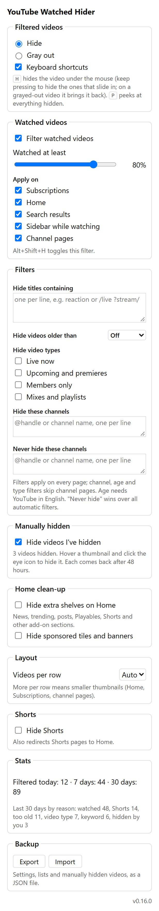
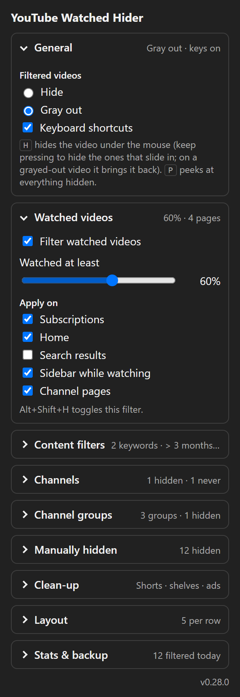

# YouTube Watched Hider

Chrome extension (Manifest V3, no build step, no dependencies):

- **Watched videos:** hides or grays out videos you've watched past a threshold (default 80%) on Subscriptions, Home, Search, the watch-page sidebar and channel pages. Each page can be switched on or off.
- **Manual hide:** hover a thumbnail and click the eye icon to hide that video everywhere, with Undo. They follow the Hide / Gray out choice; when grayed out, the same button becomes an eye icon that shows the video again. Switch "Hide videos I've hidden" off to show them again without losing the list. Each hide expires automatically 48 hours after you made it. Stored locally on this device.
- **Keyword filter:** hide videos whose title contains a word, or matches a `/pattern/` (regular expression).
- **Age filter:** hide videos older than 1 day to 1 year (not on channel pages; reads YouTube's English "… ago" text).
- **Channel blocklist:** always hide videos from channels you list (by `@handle` or name).
- **Never hide:** channels you list are never hidden by any automatic filter.
- **Shorts:** optionally hides Shorts shelves, Shorts cards and the sidebar entry, and redirects `/shorts/` pages to Home.
- **Tile size:** choose how many videos per row (Auto or 3–8) for smaller thumbnails on Home, Subscriptions and channel pages.
- **Badge:** the toolbar icon shows how many items were hidden on the current page.
- **Settings button:** a button next to YouTube's search bar opens the settings in a panel, so you don't need to pin the extension.
- **Keyboard:** <kbd>H</kbd> hides the video under the mouse (keep pressing to clear the videos that slide into its place; on a grayed-out video, H brings it back), <kbd>P</kbd> peeks at everything hidden (outlined, with a bar to exit). Can be switched off in settings.
- **Shortcut:** `Alt+Shift+H` toggles the watched filter (change it at `chrome://extensions/shortcuts`).

## Settings

Open the settings from the toolbar icon or the button next to YouTube's search bar. Changes apply instantly.

<table>
  <tr>
    <td align="center"></td>
    <td align="center"></td>
  </tr>
  <tr>
    <td align="center">Defaults: hide anything watched past 80%</td>
    <td align="center">Gray out at 60%, keep a favorite channel, 5 per row, no Shorts</td>
  </tr>
</table>

## Install (release)
1. Download the latest `youtube-watched-hider-<version>.zip` from [Releases](https://github.com/Eddy93-dev/YoutubePlugin/releases/latest) and unzip it to a folder you'll keep.
2. Open `chrome://extensions`, turn on **Developer mode**, click **Load unpacked** and pick that folder.
3. To update, unzip the new version over the same folder and click reload ↻ on the extension's card.

## Install (development)
1. Open `chrome://extensions` and turn on **Developer mode**.
2. Click **Load unpacked** and pick this folder.
3. Click the extension icon to change settings. Changes apply immediately.

## Scripts
- `npm test`: unit tests for `lib.js`
- `npm run icons`: regenerate `icons/*.png`
- `npm run pack`: build `dist/youtube-watched-hider-<version>.zip` for the Chrome Web Store

## Publishing to the Chrome Web Store
1. Bump `version` in `manifest.json`, then run `npm run pack`.
2. Upload the zip at the [Developer Dashboard](https://chrome.google.com/webstore/devconsole) (one-time $5 registration).
3. Privacy tab: the extension collects no user data. Settings stay in `chrome.storage.sync`. The only permission is `storage`, and the only host is `www.youtube.com`, used by the content script.
4. Add a 1280×800 screenshot and a short description.

## Versioning and releases
`version` in `manifest.json` is the single source of truth; the settings panel shows it at the bottom.
Bump the minor version for each new feature (0.4.0 → 0.5.0) and the patch version for fixes (0.4.0 → 0.4.1).

CI (`.github/workflows/ci.yml`) runs the tests and builds the package on every push and pull request.
When a push to `main` carries a version that has no release yet, it tags `v<version>` and publishes a
GitHub Release with the zip attached. Pushing a version bump is all it takes to release.

## Maintenance
YouTube changes its markup often. If filtering stops working, update the `SEL` selectors at the top of `content.js`.
